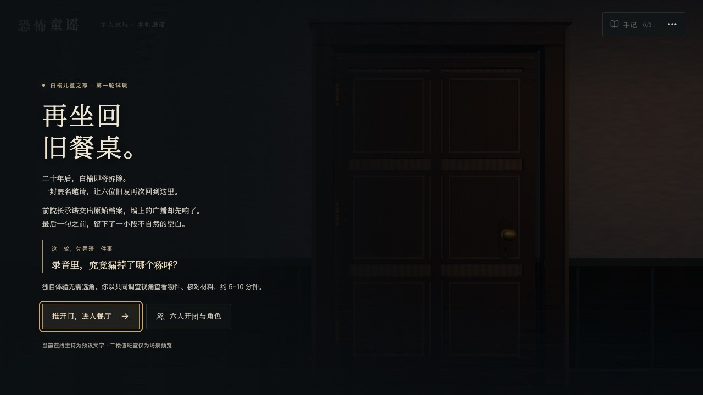
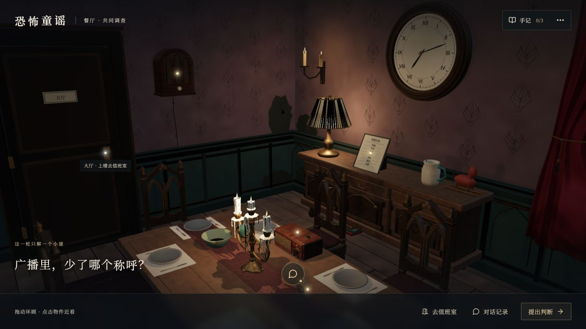
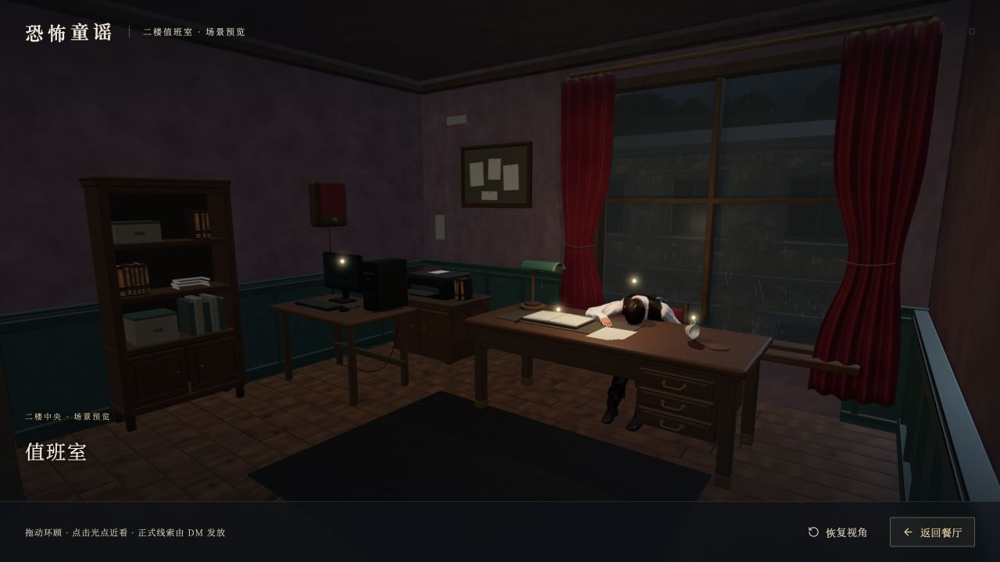

# 恐怖童谣 · 游戏 Demo

**走进一间雨夜旧宅，从旧广播、磁带和生活旧物里，找回一句话中缺失的称呼。**

**[剧本与角色预览 →](https://xianyun790-afk.github.io/kongbu-tongyao/script/)** · **[进入 3D 游戏试玩 →](https://xianyun790-afk.github.io/kongbu-tongyao/)**

[我的制作思路](docs/制作思路.md) · [素材来源与署名](public/models/dining-loop/ASSET-CREDITS.txt)

建议先用电脑浏览器体验；首次进入需要加载三维模型。

**v0.2.1 · 2026-11-09：先看简约剧本介绍，再决定怎样开始。** 新增独立的[剧本与角色预览](https://xianyun790-afk.github.io/kongbu-tongyao/script/)，用故事、六个角色和入场指南三个区块介绍完整文本玩法；3D 游戏继续保留原入口。

| 体验 | 适合怎样玩 | 范围 |
| --- | --- | --- |
| 完整文本剧本 MP1.0 | 6 位真人玩家，60–90 分钟；真人主持时另需 1 位 DM，AI 主持需另行配置 | 三轮文字剧本，由组织者私发当前轮材料；不是当前 3D 游戏已实现的完整流程 |
| 3D 餐厅小谜 | 单人，约 5–10 分钟，无需选角 | 调查餐厅三组公开材料，找回缺失称呼；二楼为场景预览 |
| 六人共屏第一轮 | 6 位真人，设计时长约 20–30 分钟，尚待六人盲测 | 操作员共享一块游戏屏幕，组织者私发第一轮短本，大家用共同语音讨论；各设备不会同步 |

阅读站只公开前情、规则和六位角色简介，不提供私人剧本或答案。“记下偏好”只保存在本设备；复制选角意向后，请发给邀请你的人确认。

[下载公共开团说明（ZIP）](public/play-kit/round-one-public-v0.2.0.zip) · [阅读公共规则](public/play-kit/玩家公共规则.md) · [查看六人公开选角册](public/play-kit/公开选角册.md)

这份公开下载只有规则和角色简介。**个人短本及含答案的 DM 资料由制作者另行交给组织者，不放在公开仓库。** 不要将组织者总包发进玩家群。

**语音状态：**2026-11-09 已重新启动制作电脑上的 AI 中转，原本机 SenseVoice 转写、SenseNova 问答和 MiniMax「电台男主播」链路恢复。此次是本机进程恢复，公开后端的核心会话与资料核对代码已与本机一致；没有把本机服务部署到公网。**GitHub 在线页仍为预设文字模式，不能使用在线语音**，需另有能访问内网语音服务的 HTTPS/WSS 后端。[语音接入与部署说明](docs/语音部署说明.md) · [本机恢复说明](docs/本机语音恢复.md) · [独立后端代码](backend/)





## 我想做什么

我想把剧本杀里的“看材料”，变成“走进现场找材料”。玩家可以自己选择调查对象，在真实的三维房间里环顾、近看、比较线索，再提出有依据的判断。

最初的版本有较多步骤和文字，玩起来容易像依次读完流程。后来我把方向收小：先做一个约 **5—10 分钟**、能够完整解开的小谜，确认场景、引导和反馈能连起来，再扩展更长的故事。

游戏方向是 **6 名真人扮演角色，AI 担任公共 DM**：真人保管自己的角色本、讨论和作决定；DM 引导进程、核对已公开的信息。当前在线版可人工组织六人共屏第一轮，主持使用预设文字提示，完整的联网 AI 主持仍需单独配置后端。

## 现在可以玩到什么

- **开团入口**：公共故事、六位角色简介、选角意向复制和三项人工准备确认；在场景顶部可随时重看说明。
- **餐厅小谜**：自由查看三组公开材料，比较线索，在手记中回看，引用材料提交判断，获得反馈与阶段成果。
- **真实 3D 场景**：拖动环顾、滚轮缩放、点击柔光热点近看；开门后镜头推进房间，物件说明以居中纸卡呈现。
- **值班室预览**：经过短转场进入另一个房间，查看书桌、旧台机和现场细节，再返回餐厅。
- **文字主持**：通过对话入口询问调查方向，获得依据已公开材料编写的预设提示。
- **本机进度**：单人和六人共屏分开保存，旧单人记录保留，也可以导出手记。组团时由操作员记录大家已经公开的内容，其他设备不会同步。



单人操作：**拖动环顾 → 点击物件 → 比对材料 → 提出判断**。六人共屏时，先完成选角和短本私发，再由操作员按大家的请求查看物件；公开许知音的磁带前，操作员须收到该玩家的明确分享请求。按 `Esc` 可关闭卡片或退出相应状态；“试玩说明与物件目录”提供调查入口和重开选项。

默认公开版本是 **静态网页 Demo**。未配置 HTTPS 后端时使用预设文字主持，不采集麦克风。仓库已提供可选实时 DM 与 MiniMax 语音接入，需按部署说明另行启用。真人联机同步、私人角色分发和完整第二轮尚未实现；值班室目前只开放场景预览。

## 本地运行

需要 **Node.js 24** 与 npm。

```sh
npm ci
npm run dev
```

打开终端显示的地址，默认入口为 `http://127.0.0.1:4184/kongbu-tongyao/`。

```sh
npm test          # 检查推理、存档、字幕与镜头边界等行为
npm run build    # 类型检查并构建到 dist/
npm run preview  # 在本机预览构建结果
```

技术：React、TypeScript、Vite、Three.js；场景使用真实网格、材质和实时光影。仓库内的 GitHub Actions 工作流负责构建并发布到 GitHub Pages，项目路径为 `/kongbu-tongyao/`。

## 创作与素材

本项目受芒果 TV《明星大侦探·恐怖童谣》的悬疑氛围启发，是个人非官方概念 Demo，与节目及其权利方无隶属关系；此展示不代表获得官方改编授权。

场景由自行制作的几何与有来源记录的外部素材共同构成，并非所有素材均为原创。人物采用 Renderpeople 的 CC BY 4.0 模型并调整姿势与材质；部分纹理、瓷杯及夜景来自 Poly Haven、OpenGameArt 等来源。完整作者、许可和修改说明见[素材署名](public/models/dining-loop/ASSET-CREDITS.txt)，字体许可随文件保留于 `public/fonts/`。

源码、剧情、模型、纹理和字体分别适用其对应权利与许可；本仓库未为整个项目授予统一的 MIT 或其他开源许可。
